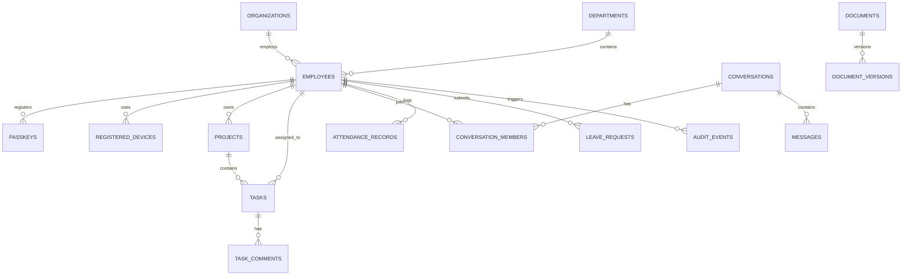

# SocialHub Enterprise OS — Database Schema

**Engine:** PostgreSQL 16+  
**Primary Key Convention:** UUIDv4 (`gen_random_uuid()`)  
**Timestamp Convention:** `timestamptz` (UTC)  
**ORM:** Prisma with reviewed SQL migration files  

---

## 1. Complete Table Catalog by Module

---

## 2. Table Definitions

### 2.1 Identity & Access Management (Module 01)

#### `organizations`
- `id` (UUID, PK)
- `name` (VARCHAR(255), NOT NULL)
- `domain` (VARCHAR(255), UNIQUE, NOT NULL)
- `is_active` (BOOLEAN, DEFAULT true)
- `created_at` (TIMESTAMPTZ, DEFAULT now())

#### `users` (Authentication Credentials)
- `id` (UUID, PK)
- `organization_id` (UUID, FK `organizations.id`, NOT NULL)
- `email` (VARCHAR(255), UNIQUE, NOT NULL)
- `password_hash` (TEXT, NULL) — Argon2id hash (null if pure passkey)
- `mfa_secret` (TEXT, NULL) — Encrypted TOTP secret
- `mfa_enabled` (BOOLEAN, DEFAULT false)
- `failed_login_attempts` (INT, DEFAULT 0)
- `locked_until` (TIMESTAMPTZ, NULL)
- `created_at` (TIMESTAMPTZ, DEFAULT now())
- `updated_at` (TIMESTAMPTZ, DEFAULT now())

#### `passkeys`
- `id` (UUID, PK)
- `user_id` (UUID, FK `users.id`, NOT NULL)
- `credential_id` (TEXT, UNIQUE, NOT NULL)
- `public_key` (BYTEA, NOT NULL)
- `counter` (BIGINT, DEFAULT 0)
- `transports` (TEXT[], DEFAULT '{}')
- `device_name` (VARCHAR(150), NOT NULL)
- `created_at` (TIMESTAMPTZ, DEFAULT now())
- `last_used_at` (TIMESTAMPTZ, NULL)

#### `sessions`
- `id` (UUID, PK) — JTI
- `user_id` (UUID, FK `users.id`, NOT NULL)
- `device_id` (UUID, FK `registered_devices.id`, NULL)
- `ip_address` (INET, NOT NULL)
- `user_agent` (TEXT, NOT NULL)
- `expires_at` (TIMESTAMPTZ, NOT NULL)
- `last_activity_at` (TIMESTAMPTZ, DEFAULT now())
- `revoked_at` (TIMESTAMPTZ, NULL)

#### `registered_devices`
- `id` (UUID, PK)
- `user_id` (UUID, FK `users.id`, NOT NULL)
- `device_fingerprint` (VARCHAR(255), NOT NULL)
- `device_name` (VARCHAR(255), NOT NULL)
- `os` (VARCHAR(100), NOT NULL)
- `browser` (VARCHAR(100), NOT NULL)
- `status` (VARCHAR(50), DEFAULT 'PENDING') — `PENDING`, `APPROVED`, `REVOKED`
- `registered_at` (TIMESTAMPTZ, DEFAULT now())
- `last_seen_at` (TIMESTAMPTZ, DEFAULT now())

---

### 2.2 Employee & Department Management (Modules 02 & 03)

#### `departments`
- `id` (UUID, PK)
- `organization_id` (UUID, FK `organizations.id`, NOT NULL)
- `name` (VARCHAR(150), NOT NULL)
- `code` (VARCHAR(50), NOT NULL)
- `head_employee_id` (UUID, NULL) — Self FK to `employees.id`
- `created_at` (TIMESTAMPTZ, DEFAULT now())

#### `designations`
- `id` (UUID, PK)
- `organization_id` (UUID, FK `organizations.id`, NOT NULL)
- `title` (VARCHAR(150), NOT NULL)
- `department_id` (UUID, FK `departments.id`, NOT NULL)

#### `employees`
- `id` (UUID, PK)
- `organization_id` (UUID, FK `organizations.id`, NOT NULL)
- `user_id` (UUID, FK `users.id`, UNIQUE, NOT NULL)
- `employee_code` (VARCHAR(50), UNIQUE, NOT NULL)
- `full_name` (VARCHAR(255), NOT NULL)
- `phone` (VARCHAR(50), NULL)
- `profile_picture_url` (TEXT, NULL)
- `department_id` (UUID, FK `departments.id`, NULL)
- `designation_id` (UUID, FK `designations.id`, NULL)
- `reporting_manager_id` (UUID, FK `employees.id`, NULL)
- `joining_date` (DATE, NOT NULL)
- `status` (VARCHAR(50), DEFAULT 'ACTIVE') — `INVITED`, `ACTIVE`, `ON_LEAVE`, `SUSPENDED`, `TERMINATED`
- `employment_type` (VARCHAR(50), DEFAULT 'FULL_TIME')
- `work_location` (VARCHAR(150), DEFAULT 'OFFICE')
- `created_at` (TIMESTAMPTZ, DEFAULT now())

#### `teams` & `team_members`
- `id` (UUID, PK)
- `name` (VARCHAR(150), NOT NULL)
- `department_id` (UUID, FK `departments.id`, NOT NULL)
- `team_members`: junction table (`team_id`, `employee_id`, `role`)

---

### 2.3 Task & Project Management (Modules 04 & 05)

#### `projects`
- `id` (UUID, PK)
- `organization_id` (UUID, FK `organizations.id`, NOT NULL)
- `name` (VARCHAR(255), NOT NULL)
- `description` (TEXT, NULL)
- `owner_id` (UUID, FK `employees.id`, NOT NULL)
- `department_id` (UUID, FK `departments.id`, NULL)
- `status` (VARCHAR(50), DEFAULT 'PLANNING') — `PLANNING`, `ACTIVE`, `ON_HOLD`, `COMPLETED`, `ARCHIVED`
- `priority` (VARCHAR(20), DEFAULT 'MEDIUM')
- `start_date` (DATE, NULL)
- `end_date` (DATE, NULL)
- `budget` (DECIMAL(14,2), NULL)
- `created_at` (TIMESTAMPTZ, DEFAULT now())

#### `tasks`
- `id` (UUID, PK)
- `project_id` (UUID, FK `projects.id`, NOT NULL)
- `title` (VARCHAR(255), NOT NULL)
- `description` (TEXT, NULL)
- `assigned_to` (UUID, FK `employees.id`, NOT NULL)
- `created_by` (UUID, FK `employees.id`, NOT NULL)
- `priority` (VARCHAR(20), DEFAULT 'MEDIUM') — `LOW`, `MEDIUM`, `HIGH`, `URGENT`
- `status` (VARCHAR(50), DEFAULT 'TODO') — `BACKLOG`, `TODO`, `IN_PROGRESS`, `IN_REVIEW`, `CHANGES_REQUESTED`, `APPROVED`, `COMPLETED`, `BLOCKED`, `CANCELLED`
- `start_date` (DATE, NULL)
- `due_date` (DATE, NULL)
- `estimated_effort_hours` (DECIMAL(6,2), NULL)
- `actual_effort_hours` (DECIMAL(6,2), NULL)
- `completed_at` (TIMESTAMPTZ, NULL)
- `created_at` (TIMESTAMPTZ, DEFAULT now())

#### `task_activity_events` (Immutable History)
- `id` (UUID, PK)
- `task_id` (UUID, FK `tasks.id`, NOT NULL)
- `actor_id` (UUID, FK `employees.id`, NOT NULL)
- `action` (VARCHAR(100), NOT NULL)
- `previous_state` (JSONB, NULL)
- `new_state` (JSONB, NULL)
- `created_at` (TIMESTAMPTZ, DEFAULT now())

#### `task_comments` & `task_attachments`
- Relational comment threads and document links linked to `tasks.id`.

---

### 2.4 Internal Messaging (Module 06)

#### `conversations`
- `id` (UUID, PK)
- `organization_id` (UUID, FK `organizations.id`, NOT NULL)
- `type` (VARCHAR(50), NOT NULL) — `DIRECT`, `GROUP`, `DEPARTMENT`, `PROJECT`, `ANNOUNCEMENT`
- `title` (VARCHAR(255), NULL)
- `department_id` (UUID, FK `departments.id`, NULL)
- `project_id` (UUID, FK `projects.id`, NULL)
- `created_by` (UUID, FK `employees.id`, NOT NULL)
- `created_at` (TIMESTAMPTZ, DEFAULT now())

#### `conversation_members`
- `id` (UUID, PK)
- `conversation_id` (UUID, FK `conversations.id`, NOT NULL)
- `employee_id` (UUID, FK `employees.id`, NOT NULL)
- `joined_at` (TIMESTAMPTZ, DEFAULT now())
- `last_read_message_id` (UUID, NULL)

#### `messages`
- `id` (UUID, PK)
- `conversation_id` (UUID, FK `conversations.id`, NOT NULL)
- `sender_id` (UUID, FK `employees.id`, NOT NULL)
- `content` (TEXT, NOT NULL)
- `reply_to_id` (UUID, FK `messages.id`, NULL)
- `is_pinned` (BOOLEAN, DEFAULT false)
- `created_at` (TIMESTAMPTZ, DEFAULT now())
- `edited_at` (TIMESTAMPTZ, NULL)

---

### 2.5 Attendance & Leave Management (Module 07)

#### `attendance_records`
- `id` (UUID, PK)
- `employee_id` (UUID, FK `employees.id`, NOT NULL)
- `date` (DATE, NOT NULL)
- `check_in_at` (TIMESTAMPTZ, NOT NULL)
- `check_out_at` (TIMESTAMPTZ, NULL)
- `total_hours` (DECIMAL(5,2), NULL)
- `status` (VARCHAR(50), DEFAULT 'PRESENT') — `PRESENT`, `HALF_DAY`, `LATE`, `ABSENT`
- `created_at` (TIMESTAMPTZ, DEFAULT now())

#### `leave_requests`
- `id` (UUID, PK)
- `employee_id` (UUID, FK `employees.id`, NOT NULL)
- `leave_type` (VARCHAR(50), NOT NULL) — `SICK`, `CASUAL`, `ANNUAL`, `UNPAID`
- `start_date` (DATE, NOT NULL)
- `end_date` (DATE, NOT NULL)
- `reason` (TEXT, NOT NULL)
- `status` (VARCHAR(50), DEFAULT 'PENDING') — `PENDING`, `APPROVED`, `REJECTED`, `CANCELLED`
- `reviewed_by` (UUID, FK `employees.id`, NULL)
- `reviewed_at` (TIMESTAMPTZ, NULL)

---

### 2.6 Documents & S3 Storage (Module 08)

#### `documents`
- `id` (UUID, PK)
- `organization_id` (UUID, FK `organizations.id`, NOT NULL)
- `owner_id` (UUID, FK `employees.id`, NOT NULL)
- `title` (VARCHAR(255), NOT NULL)
- `category` (VARCHAR(100), NOT NULL)
- `classification` (VARCHAR(50), DEFAULT 'INTERNAL') — `PUBLIC`, `INTERNAL`, `CONFIDENTIAL`, `RESTRICTED`
- `s3_key` (TEXT, NOT NULL)
- `s3_bucket` (VARCHAR(255), NOT NULL)
- `mime_type` (VARCHAR(100), NOT NULL)
- `file_size_bytes` (BIGINT, NOT NULL)
- `version` (INT, DEFAULT 1)
- `created_at` (TIMESTAMPTZ, DEFAULT now())

---

### 2.7 Social Media Management (Module 09)

Retaining existing models with enhanced publication pipeline:
- `social_accounts` (`instagram_accounts`)
- `account_tokens` (`account_connections`, Fernet/KMS encrypted tokens)
- `campaigns` & `clients`
- `publication_groups` & `publications`
- `publication_attempts`
- `outbox_events` (Transactional outbox relay)

---

### 2.8 Enterprise Security & Audit (Module 12)

#### `security_incidents`
- `id` (UUID, PK)
- `organization_id` (UUID, FK `organizations.id`, NOT NULL)
- `actor_id` (UUID, FK `employees.id`, NOT NULL)
- `event_type` (VARCHAR(100), NOT NULL) — `SCREENSHOT_KEY_DETECTED`, `FOCUS_LOST_SUSPICIOUS`, `DEVTOOLS_OPENED`, `UNAUTHORIZED_ACCESS_ATTEMPT`
- `severity` (VARCHAR(20), DEFAULT 'MEDIUM') — `LOW`, `MEDIUM`, `HIGH`, `CRITICAL`
- `route` (TEXT, NOT NULL)
- `ip_address` (INET, NOT NULL)
- `user_agent` (TEXT, NOT NULL)
- `status` (VARCHAR(50), DEFAULT 'OPEN') — `OPEN`, `UNDER_REVIEW`, `RESOLVED`, `FALSE_POSITIVE`
- `resolved_by` (UUID, FK `employees.id`, NULL)
- `resolution_notes` (TEXT, NULL)
- `created_at` (TIMESTAMPTZ, DEFAULT now())

#### `audit_events` (Append-Only)
- `id` (UUID, PK)
- `actor_id` (UUID, NULL)
- `organization_id` (UUID, NOT NULL)
- `action` (VARCHAR(100), NOT NULL)
- `resource_type` (VARCHAR(100), NOT NULL)
- `resource_id` (UUID, NULL)
- `ip_address` (INET, NULL)
- `session_id` (UUID, NULL)
- `sanitized_metadata` (JSONB, NOT NULL)
- `created_at` (TIMESTAMPTZ, DEFAULT now())
