# SocialHub Enterprise OS — Development Roadmap

**Version:** 2.0  
**Methodology:** Phase-wise milestone delivery with mandatory definition-of-done criteria  

---

## 1. High-Level Delivery Timeline

```mermaid
flowchart LR
    P0["Phase 0: Foundations"] --> P1["Phase 1: Engineering Infra"]
    P1 --> P2["Phase 2: Identity & Security"]
    P2 --> M1{{"Milestone 1: Secure Workspace"}}
    M1 --> P3["Phase 3: Employee Lifecycle"]
    P3 --> P4["Phase 4: Tasks & Projects"]
    P4 --> P5["Phase 5: Messaging"]
    P5 --> P6["Phase 6: Attendance & Leave"]
    P6 --> P7["Phase 7: Documents"]
    P7 --> P8["Phase 8: Social Publishing"]
    P8 --> P9["Phase 9: Security Center & DLP"]
    P9 --> P10["Phase 10: Dashboards & Analytics"]
    P10 --> P11["Phase 11: Security Validation"]
    P11 --> P12["Phase 12: Production Rollout"]
    P12 --> P13["Phase 13: Optimization"]
```



---

## 2. Milestone 1 — Secure Employee Workspace (First Priority)

The first working milestone proves the foundational pillars of the operating system:

```text
SUPER ADMIN LOGIN
       |
       v
REGISTER COMPANY ADMIN
       |
       v
CREATE DEPARTMENTS
       |
       v
INVITE EMPLOYEES
       |
       v
EMPLOYEE COMPLETES MFA
       |
       v
REGISTER AUTHORIZED DEVICE
       |
       v
EMPLOYEE OPENS DASHBOARD
       |
       v
MANAGER CREATES PROJECT
       |
       v
MANAGER ASSIGNS TASK
       |
       v
EMPLOYEE RECEIVES NOTIFICATION
       |
       v
EMPLOYEE COMPLETES TASK
       |
       v
MANAGER REVIEWS AND APPROVES
       |
       v
ACTIVITY HISTORY RECORDED
```

---

## 3. Detailed Phase Breakdown

### Phase 0 — Requirements & Foundations (Current)
- **Deliverables:** Architectural specifications, Threat model, Database conventions, Permission matrix, API schemas, and Documentation suite.
- **Exit Criteria:** Architecture approved; development scope aligned; all 11 required docs established.

### Phase 1 — Engineering Foundation & Monorepo
- **Deliverables:** Next.js frontend, NestJS backend API, PostgreSQL with Prisma schema, Redis + BullMQ queuing, Docker Compose environment, GitHub Actions CI.
- **Exit Criteria:** Application boots cleanly; migrations run idempotently; CI lint/test suites pass.

### Phase 2 — Identity, MFA & Device Registration
- **Deliverables:** WebAuthn passkey registration, TOTP enrollment, server session cookies, device registration flow, rate limiting, and session revocation.
- **Exit Criteria:** Passkey and TOTP authentication tests pass; device trust evaluated on login; zero plaintext credentials.

### Phase 3 — Employee & Department Management
- **Deliverables:** Department creation, employee invitation pipeline, designation mapping, reporting managers, and offboarding workflows.
- **Exit Criteria:** Super Admin can onboard employees; offboarding instantly revokes active sessions and reassigns workloads.

### Phase 4 — Project & Task Management
- **Deliverables:** Project scoping, milestones, task creation, multi-assignee tracking, status transitions (`BACKLOG` -> `COMPLETED`), immutable `task_activity_events` trail.
- **Exit Criteria:** Complete task delegation and approval workflow operational with audit trail.

### Phase 5 — Company-Managed Internal Messaging
- **Deliverables:** 1:1 direct chat, group channels, department announcements, WebSocket gateway, typing status, attachment storage.
- **Exit Criteria:** End-to-end real-time chat with permission checks and token regex redaction.

### Phase 6 — Attendance & Leave Governance
- **Deliverables:** Server-timestamped check-in/out, leave applications, manager approvals, holiday calendar, and monthly attendance reports.
- **Exit Criteria:** Accurate attendance tracking without reliance on client clock or covert location trackers.

### Phase 7 — Document Repository & Private S3 Storage
- **Deliverables:** S3 presigned upload/download, classification labeling, document versioning, malware scan hooks.
- **Exit Criteria:** Zero public S3 bucket access; short-lived signed URLs; document access audited.

### Phase 8 — Social Media Management (Meta Instagram & Facebook)
- **Deliverables:** Meta OAuth integration, account inventory, hybrid post scheduler, BullMQ publication workers, transactional outbox sweeper.
- **Exit Criteria:** Reliable publishing to Instagram and Facebook with idempotency and automated error recovery.

### Phase 9 — Enterprise Security Center & DLP
- **Deliverables:** Dynamic forensic watermarking, capture shortcut interception, security incident triage dashboard, emergency lockdown switch.
- **Exit Criteria:** Real-time capture alerts dispatch to admins; forensic watermarking active across protected screens.

### Phase 10 — Reports & Analytics Dashboards
- **Deliverables:** Four specialized dashboards (Organization, Employee, Manager, Social Media).
- **Exit Criteria:** Metrics respect role-based visibility; background export jobs for large audit reports.

### Phase 11 — Security Validation & Penetration Testing
- **Deliverables:** OWASP ASVS verification, privilege escalation tests, concurrency tests, and disaster recovery simulation.
- **Exit Criteria:** Zero high-severity vulnerabilities; verified backup restore pipeline.

### Phase 12 — Production Rollout
- **Deliverables:** Staged internal pilot, user training materials, admin runbooks, live AWS deployment.
- **Exit Criteria:** Seamless migration of active accounts and zero downtime transition.

### Phase 13 — Enterprise Optimization
- **Deliverables:** Query index tuning, Redis cache layer optimization, messaging throughput scaling, worker concurrency balancing.
- **Exit Criteria:** P95 API response times under 500ms; messaging delivery under 2 seconds.
