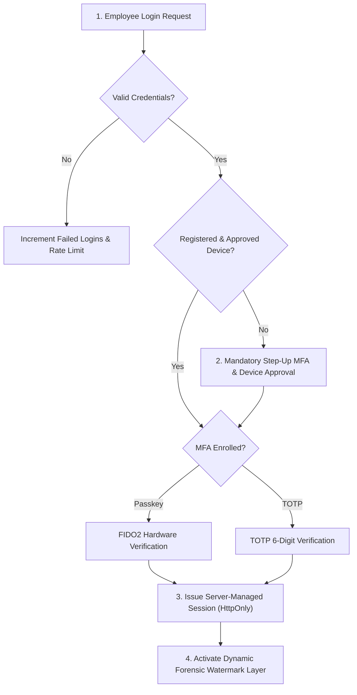

# SocialHub Enterprise OS — Security Architecture

**Security Philosophy:** Zero Trust, Defense-in-Depth, Principle of Least Privilege  
**Compliance Standards:** OWASP ASVS Level 2, SOC 2 Type II alignment  

---

## 1. Zero Trust Identity & Authentication

### 1.1 Multi-Factor Authentication (MFA)
- **Primary:** WebAuthn / FIDO2 Passkeys (Touch ID, Windows Hello, YubiKey) bound directly to domain origin. Phishing resistant.
- **Secondary:** RFC 6238 TOTP (Google Authenticator, Microsoft Authenticator) with encrypted server secrets.
- **Strict Enforcement:** Passkeys or TOTP required for all users; no bypass in production environments.

### 1.2 Device Registration & Trust Evaluation
- **Hardware Binding:** On enrollment, generates a device-bound keypair and records browser, OS, and client parameters.
- **New Device Workflow:** Unrecognized devices trigger step-up verification and require explicit administrative or email approval before granting access to confidential modules.
- **Emergency Device Revocation:** Administrators can revoke an employee's registered device with one click, terminating all associated active sessions.

---

## 2. Anti-Screenshot & Screen Capture Protection

### 2.1 Technical Browser Realities
Browsers run in unprivileged sandboxes and **cannot** block third-party OS-level recording tools (OBS, Discord screen share, Snipping Tool) or physical smartphone photography. Anyone claiming 100% screenshot blocking in pure web browsers is misleading.

### 2.2 Enterprise Defense-in-Depth Mitigation
We enforce a comprehensive multi-tier strategy:

#### 1. Dynamic Forensic Watermarking
- **Visible Grid:** Semi-transparent, pointer-events-none watermark tiled across all views:
  `[EMPLOYEE_CODE] | [EMPLOYEE_NAME] | [IP_ADDRESS] | [UTC_TIMESTAMP] | STRICTLY CONFIDENTIAL`
- **Forensic Deterrence:** If an employee photographs their screen or uses an external capture tool, their identity and timestamp are indelibly stamped across the image, destroying anonymity and deterring data leaks.

#### 2. Keystroke Interception
- Intercepts capture hotkeys:
  - `PrintScreen`
  - `Win + Shift + S` / `Meta + Shift + S`
  - `Cmd + Shift + 3/4/5` (macOS)
  - `Ctrl + P` / `Cmd + P` (Print Page)
  - `Ctrl + S` / `Cmd + S` (Save Page)
  - `F12` / `Ctrl + Shift + I` (DevTools)
- Instantly calls `event.preventDefault()`.
- Flushes the system clipboard via `navigator.clipboard.writeText("")` to overwrite any captured pixel buffer.

#### 3. Viewport Obfuscation on Focus Loss
- When the window loses focus (`window.onblur` or `document.visibilityState === 'hidden'`), the sensitive document and table areas are instantly blurred (`backdrop-blur-3xl opacity-0`) to prevent background screenshot tools from grabbing clear frames.

#### 4. Real-time Security Incident Dispatch
- Any detected capture event immediately issues an asynchronous beacon to `/api/v1/security/incidents`.
- Logs the incident to the append-only `audit_events` and `security_incidents` tables.
- Broadcasts a real-time alert to Security Administrators and displays a compliance warning to the employee.

---

## 3. Data Loss Prevention (DLP) Classifications

| Classification | Visibility Scope | Download / Export Policy | Watermark Policy |
|---|---|---|---|
| **PUBLIC** | All users & marketing channels | Unrestricted | None |
| **INTERNAL** | Authenticated employees | Permitted with audit log | Standard Visible |
| **CONFIDENTIAL** | Assigned project & team members | Read-only / Approval required | High-Contrast Dynamic |
| **RESTRICTED** | Authorized administrators only | Strictly prohibited | Steganographic + High-Contrast |

---

## 4. Cryptographic Storage & Session Controls

1. **Tokens & Credentials at Rest:**
   - Meta OAuth long-lived tokens and API credentials encrypted with AES-256-GCM via AWS KMS envelope encryption.
   - Database stores ciphertext and encrypted data key; plaintext exists in memory only during active API requests.
2. **Session Security:**
   - Server-managed session IDs stored in `sessions` table.
   - Transported via `HttpOnly`, `Secure`, `SameSite=Strict` cookies.
   - Inactivity timeout: 15 minutes of idle time forces re-authentication.
   - Absolute session lifetime: 12 hours.
   - Concurrent sessions: Strict single-device policy per employee to prevent credential sharing.
